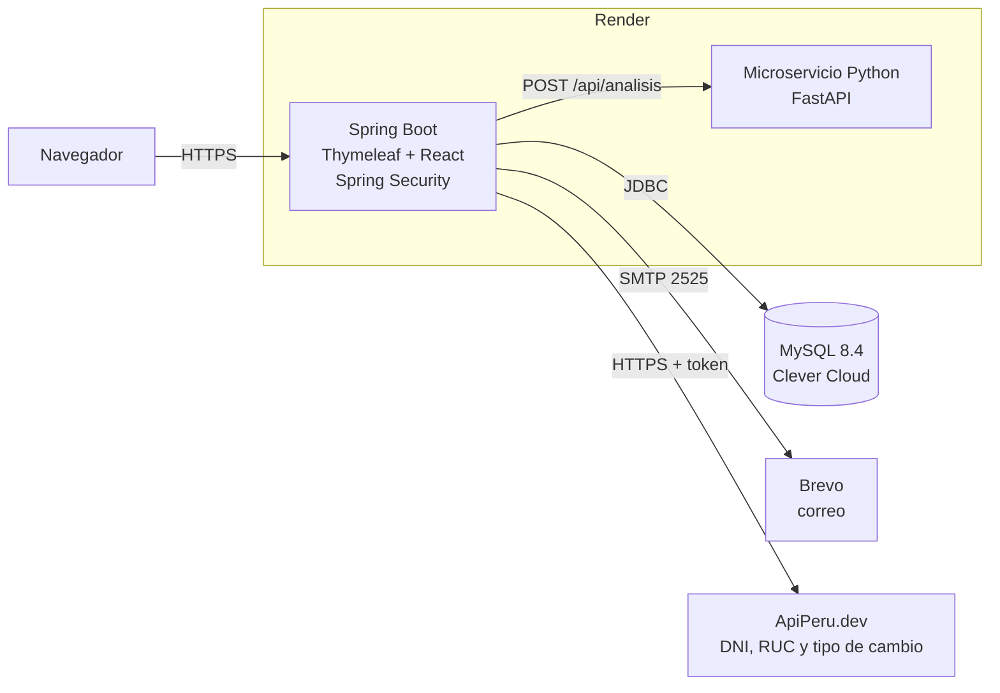
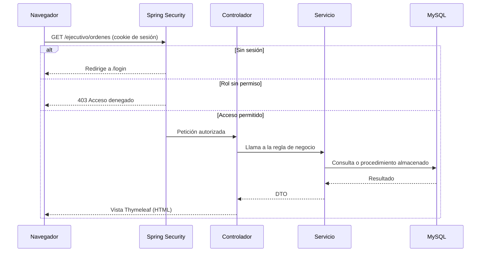
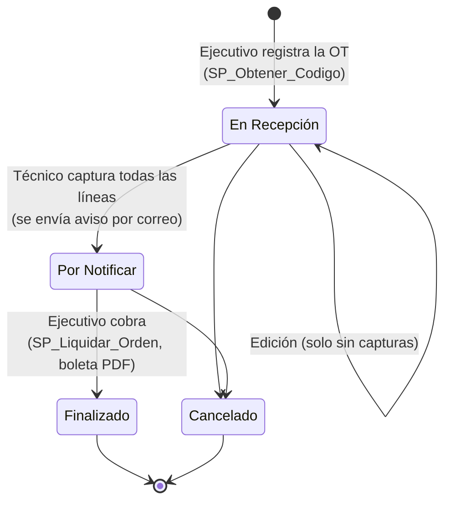
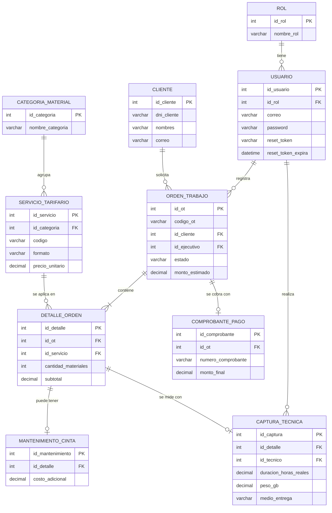

# Electrónica y Suministros S.A.C.

Sistema web para la gestión de servicios de **digitalización multimedia** (video, audio y fotografía) y **órdenes de trabajo (OT)**: recepción del material, captura técnica en laboratorio, cobro, boleta electrónica y reportes gerenciales.

Proyecto académico del curso **Marcos de Desarrollo Web** · Universidad Tecnológica del Perú · 2026.

## Enlaces

| Recurso | Enlace |
| --- | --- |
| Sistema web (aplicación principal) | https://electronica-suministros.onrender.com |
| Microservicio Python de análisis | https://electronica-python-api.onrender.com |
| Documentación interactiva del microservicio | https://electronica-python-api.onrender.com/docs |

> **Plan gratuito de Render.** Los dos servicios se suspenden tras 15 minutos sin uso. El primer acceso puede tardar alrededor de un minuto. En **Reportes**, si el análisis predictivo aparece como «no disponible», abra primero el enlace del microservicio Python para despertarlo, espere a que cargue y pulse **«Reintentar»**.

---

## Funcionalidades

**Sitio público**
- Catálogo de servicios con cotizador (listas en cascada Categoría → Formato).
- Formulario de contacto.
- Tipo de cambio referencial USD → PEN (ApiPeru.dev).

**Intranet por roles**

| Rol | Funciones |
| --- | --- |
| Administrador | Dashboard con indicadores, reportes de ventas (React + análisis predictivo en Python), tarifario, categorías y usuarios. Accede también a todo lo del Ejecutivo y del Técnico. |
| Ejecutivo | Clientes (búsqueda RENIEC / SUNAT), órdenes de trabajo, cobro, boleta PDF y envío por correo, consulta en cascada y bandeja de consultas con respuesta por correo. |
| Técnico | Cola de laboratorio, captura técnica (horas reales, peso en GB y medio de entrega) e historial de capturas. |

**Avance final**
- **Spring Security:** inicio de sesión, control de acceso por rol, contraseñas con BCrypt y protección CSRF.
- **Correo con JavaMailSender:** aviso automático cuando la OT está lista, respuesta a consultas y boleta electrónica en PDF adjunta.
- **Recuperación de contraseña** con token UUID temporal (15 minutos) y de un solo uso.
- **APIs externas (ApiPeru.dev):** DNI (RENIEC), RUC (SUNAT) y tipo de cambio con caché de 6 horas.
- **Microservicio Python (FastAPI):** crecimiento mensual, proyección por regresión lineal y recomendaciones.
- **Vista de Reportes en React + Vite** con gráficos Recharts.
- Páginas de error personalizadas (400, 403, 404 y 500).

---

## Tecnologías

| Capa | Tecnología |
| --- | --- |
| Backend | Java 21, Spring Boot 4.1.2 (Web MVC, Data JPA, Security, Mail, Validation) |
| Vistas | Thymeleaf, Bootstrap 5.3, Bootstrap Icons, Chart.js |
| Base de datos | MySQL 8.4: 12 tablas y 5 procedimientos almacenados |
| PDF | Flying Saucer + OpenPDF |
| Microservicio | Python 3, FastAPI, Uvicorn |
| Frontend de reportes | React 18, Vite 5, Recharts |
| Contenedor | Docker (compilación en dos etapas) |

---

## Arquitectura



Spring Boot es el único punto de entrada del navegador. El microservicio Python y ApiPeru.dev se consultan desde el servidor, con tiempos máximos de espera y valores de respaldo: si alguno falla, el resto del sistema sigue funcionando.

### Capas de la aplicación (MVC)

| Capa | Paquete o carpeta | Responsabilidad |
| --- | --- | --- |
| Vista | `templates/` | Páginas Thymeleaf con fragmentos reutilizables (`header`, `sidebar` y `footer`) |
| Controlador | `controller/` | Recibe la petición, llama al servicio y devuelve la vista o el JSON |
| Servicio | `service/` | Reglas de negocio, transacciones, correo, recuperación de contraseña e integraciones |
| Repositorio | `repository/` | Spring Data JPA, consultas JPQL y SQL nativo, procedimientos almacenados |
| Modelo | `entity/` y `dto/` | Entidades JPA y objetos de transferencia (formularios, proyecciones y `record`) |
| Configuración | `config/` | Spring Security, BCrypt, interceptor de roles y tareas asíncronas |

### Recorrido de una petición privada



---

## Seguridad y roles

| Ruta | Administrador | Ejecutivo | Técnico | Público |
| --- | :---: | :---: | :---: | :---: |
| `/`, `/servicios`, `/contacto`, `/login`, `/recover`, `/reset` | ✔ | ✔ | ✔ | ✔ |
| `/api/catalogo/**` | ✔ | ✔ | ✔ | ✔ |
| `/ejecutivo/**`, `/api/ordenes/**`, `/api/reniec/**` | ✔ | ✔ | — | — |
| `/tecnico/**` | ✔ | — | ✔ | — |
| `/admin/**`, `/api/reportes/**` | ✔ | — | — | — |

- Sin sesión, las páginas privadas redirigen a `/login` y las APIs responden **401**. Con un rol sin permiso se muestra la página **403**.
- Contraseñas con **BCrypt**. Los hashes SHA-256 de versiones anteriores se convierten a BCrypt solos en el primer inicio de sesión.
- **Protección CSRF** en todos los formularios y en las peticiones `fetch` que modifican datos.
- Cambio del identificador de sesión al iniciar sesión y cabeceras de seguridad (no-cache, X-Frame-Options).

---

## Flujo de la orden de trabajo



Regla de cobro: los formatos de **Video** se cobran por **horas reales** capturadas; **Audio** e **Imagen**, por **unidad**. La limpieza de cintas suma **S/ 15.00** por línea. La boleta muestra el total con **IGV (18 %)** incluido y un monto referencial en dólares.

---

## Modelo de datos



Además existen dos tablas de apoyo: `correlativo` (contadores de OT, servicios y boletas) y `mensaje_contacto` (bandeja de consultas del formulario público).

| Módulo | Tablas |
| --- | --- |
| Seguridad | `rol`, `usuario` |
| Clientes | `cliente` |
| Catálogo | `categoria_material`, `servicio_tarifario` |
| Operación | `orden_trabajo`, `detalle_orden`, `mantenimiento_cinta`, `captura_tecnica`, `comprobante_pago` |
| Apoyo | `correlativo`, `mensaje_contacto` |

### Procedimientos almacenados

| Procedimiento | Función |
| --- | --- |
| `SP_Generar_Codigo` | Genera un código correlativo único (OT-1001, ST001, B001-00000001) con bloqueo de fila |
| `SP_Obtener_Codigo` | Devuelve el siguiente código como resultado de consulta (lo usa el registro de OT) |
| `SP_Registrar_Servicio` | Registra un servicio en el tarifario con su código ST autogenerado |
| `SP_Reporte_Ventas` | Ingresos y cantidad de OT cobradas por mes de un año |
| `SP_Liquidar_Orden` | Cobra la OT: emite la boleta y la pasa a «Finalizado» en una sola transacción |

---

## API REST

| Método y ruta | Acceso | Descripción |
| --- | --- | --- |
| `GET /api/catalogo/categorias` | Público | Categorías activas |
| `GET /api/catalogo/servicios?categoria={id}` | Público | Formatos de una categoría |
| `POST /api/ordenes` · `PUT /api/ordenes/{id}` | Ejecutivo, Admin | Registra o edita una OT |
| `GET /api/ordenes/clientes` · `/cliente/{id}` · `/{id}/detalle` | Ejecutivo, Admin | Consulta en cascada Cliente → OT → Detalle |
| `GET /api/reniec/{dni}` · `/api/reniec/ruc/{ruc}` | Ejecutivo, Admin | Nombres por DNI (RENIEC) o razón social por RUC (SUNAT) |
| `GET /api/reportes/ventas-mensuales?anio=` | Admin | Ingresos por mes (`SP_Reporte_Ventas`) |
| `GET /api/reportes/formatos?anio=` | Admin | Ingresos por formato |
| `GET /api/reportes/analisis?anio=` | Admin | Análisis predictivo del microservicio Python |
| `POST /api/analisis` (microservicio Python) | Spring Boot | Recibe el historial de ventas y devuelve el análisis |

---

## Despliegue en la nube

| Componente | Servicio | Plan |
| --- | --- | --- |
| Aplicación Spring Boot (Docker) | Render | Gratuito |
| Microservicio Python | Render (segundo servicio web) | Gratuito |
| Base de datos MySQL 8.4 | Clever Cloud | DEV (gratuito) |
| Correo SMTP | Brevo, puerto 2525 | Gratuito (300 correos al día) |
| APIs de DNI, RUC y tipo de cambio | ApiPeru.dev | Gratuito |

Se usa el puerto **2525** porque el plan gratuito de Render bloquea los puertos SMTP estándar (25, 465 y 587).

### Variables de entorno

Todas las credenciales se configuran como variables de entorno (en Render) o en un archivo `.env` local. **Ninguna está en el código ni en este repositorio.**

| Variable | Uso |
| --- | --- |
| `DB_URL`, `DB_USER`, `DB_PASSWORD` | Conexión a MySQL |
| `SPRING_DATASOURCE_HIKARI_MAXIMUMPOOLSIZE` | Límite de conexiones (3 en el plan DEV de Clever Cloud) |
| `MAIL_HOST`, `MAIL_PORT`, `MAIL_USER`, `MAIL_PASSWORD`, `MAIL_FROM` | Servidor SMTP y remitente |
| `APP_BASE_URL` | URL pública, usada en el enlace del correo de recuperación |
| `APIPERU_TOKEN` | Token de ApiPeru.dev |
| `PYTHON_API_URL` | Dirección del microservicio Python |
| `MAIL_REDIRIGIR_A` | Solo para pruebas: desvía todo el correo a una cuenta. En producción queda vacía |

---

## Estructura del repositorio

```
├── database/
│   ├── 01_esquema.sql              Tablas, restricciones e índices
│   ├── 02_datos.sql                Datos de ejemplo
│   ├── 03_procedimientos.sql       Cinco procedimientos almacenados
│   └── 04_migracion_avance_final.sql
├── python-api/                     Microservicio FastAPI (main.py, requirements.txt)
├── frontend-reportes/              Código fuente de Reportes (React + Vite)
├── src/main/java/com/electronica/suministros/
│   ├── config/       Spring Security, BCrypt, interceptor y configuración
│   ├── controller/   Controladores MVC y REST
│   ├── dto/          Formularios, proyecciones y records
│   ├── entity/       Entidades JPA
│   ├── repository/   Repositorios y procedimientos almacenados
│   └── service/      Negocio, correo, recuperación e integraciones
├── src/main/resources/
│   ├── application.properties
│   ├── static/react-reportes/      Reportes en React ya compilado
│   └── templates/                  auth, error, fragments, intranet, pdf y publico
├── Dockerfile
└── pom.xml
```

---

## Ejecución en localhost

**Requisitos:** Java 21, MySQL (por ejemplo, XAMPP), Python 3.10 o superior y, solo para recompilar Reportes, Node.js 18 o superior.

1. **Base de datos:** ejecutar en orden `database/01_esquema.sql`, `02_datos.sql` y `03_procedimientos.sql`.
2. **Variables de entorno:** crear un archivo `.env` en la raíz del proyecto (junto a `pom.xml`). Está en `.gitignore` y no se sube al repositorio.
   ```
   MAIL_HOST=servidor_smtp
   MAIL_PORT=587
   MAIL_USER=usuario_smtp
   MAIL_PASSWORD=clave_smtp
   MAIL_FROM=correo_remitente
   APP_BASE_URL=http://localhost:8083
   APIPERU_TOKEN=token_de_apiperu
   PYTHON_API_URL=http://localhost:8000
   ```
3. **Microservicio Python** (en otra terminal):
   ```
   cd python-api
   pip install -r requirements.txt
   python -m uvicorn main:app --port 8000
   ```
4. **Aplicación** (desde la raíz del proyecto):
   ```
   ./mvnw spring-boot:run
   ```
   Abrir `http://localhost:8083`.
5. *(Opcional)* Recompilar la vista de Reportes:
   ```
   cd frontend-reportes
   npm install
   npm run build
   ```

---

## Ramas

| Rama | Contenido |
| --- | --- |
| `main` | Avance final: correo, tokens UUID, Spring Security, boleta por correo, ApiPeru.dev, Python y React |
| `avance3` | Avance 3: persistencia MySQL, APIs REST, DTO y procedimientos almacenados |

---

## Autor

**Giancarlo Rivas Gonzales** · Universidad Tecnológica del Perú
